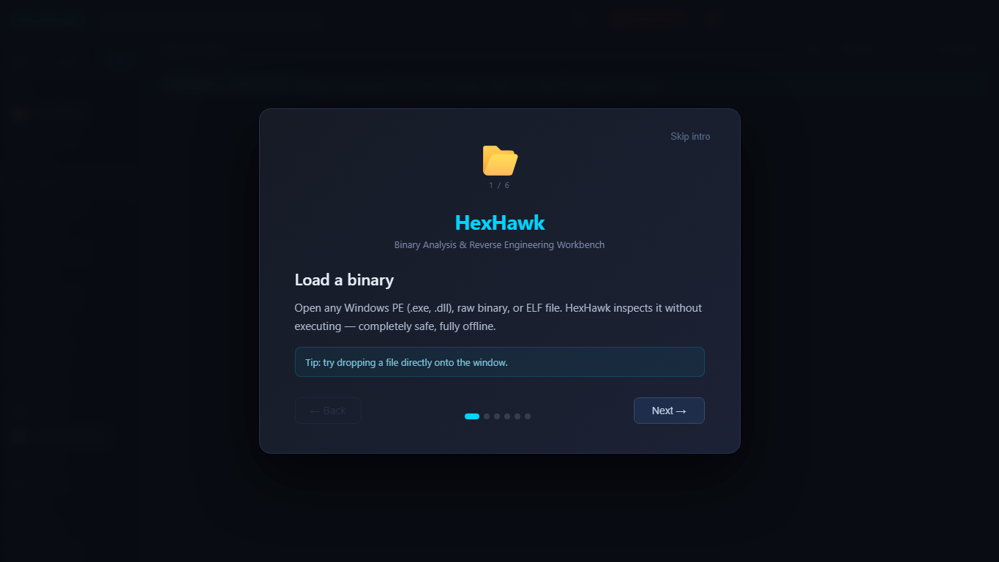
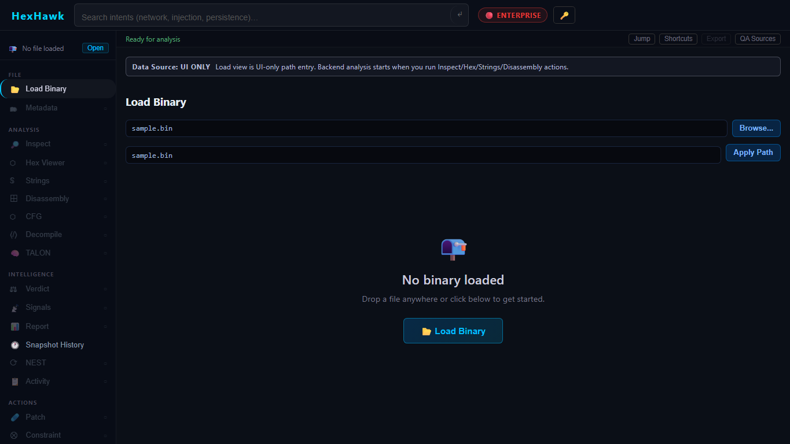
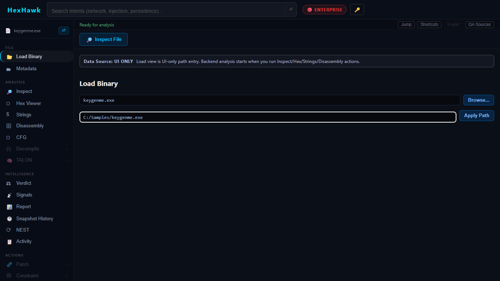
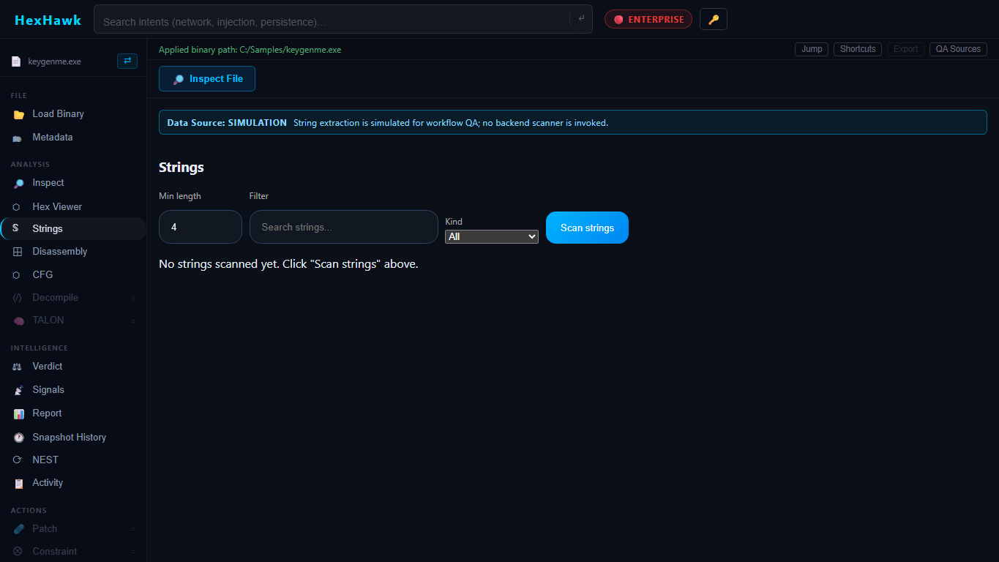
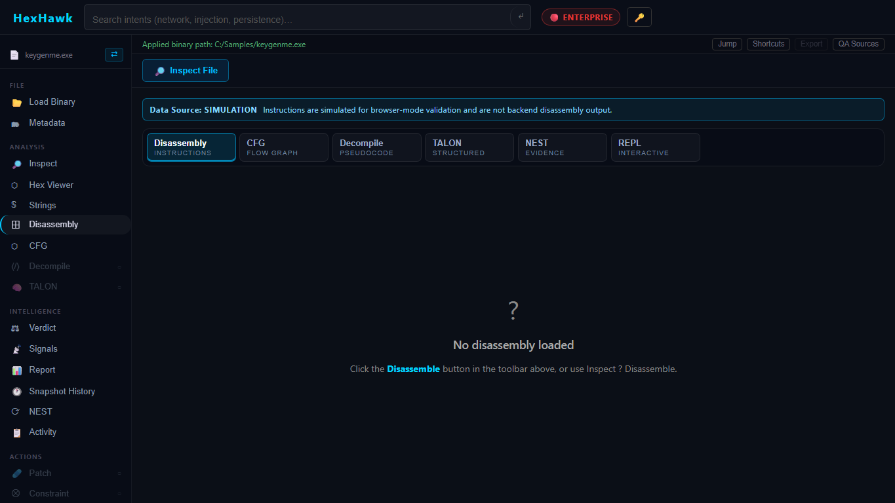
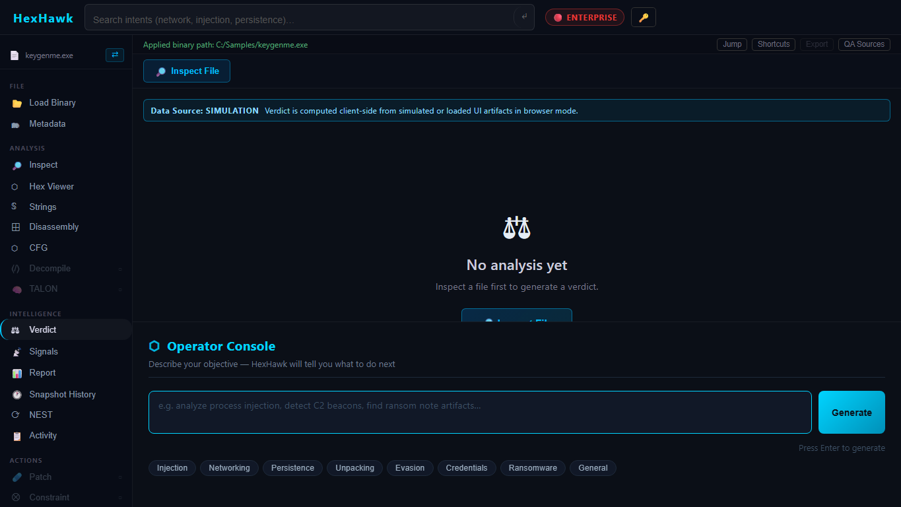
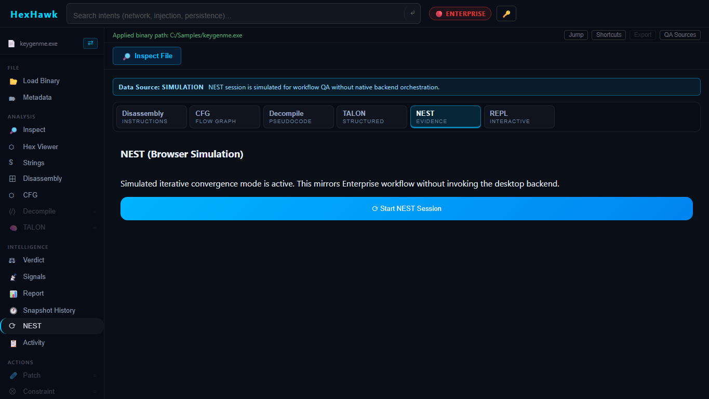
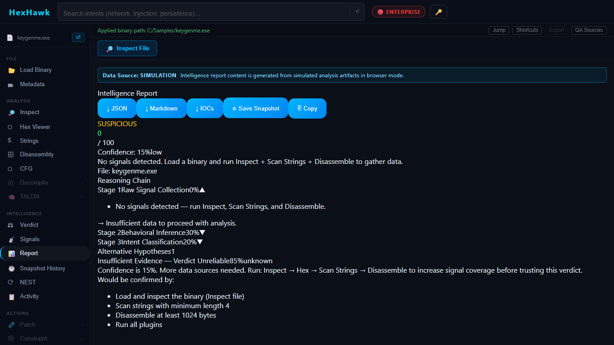
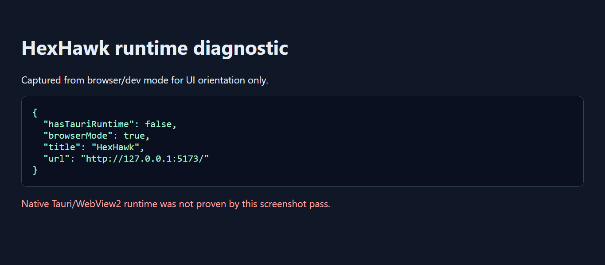

# HexHawk for Dummies

> **Bounded Windows first-release candidate — RC HOLD.** Only authorized PE32/x86 and PE32+/x64 EXE/DLL static analysis (up to 64 MiB) is in scope; never execute the input. Use Open → Inspect → Strings/Disassembly/CFG → Verdict/Signals → Report. NEST/CREST support evidence custody; no output certifies safety. Independent release, dependency/security, legal/notices and signing gates remain open.
>
> The August guide and screenshots below describe broader historical features. Skip quick-start step 7: function/decompiler workspaces are excluded here. Disabled native workflows, scripting/REPL, plugins, live debugging/memory editing, sandboxing, patching, comparison, saved-history restoration, advisory/online AI, updates and other input formats/platforms are not part of this candidate, regardless of license tier. Historical screenshots are not proof of this artifact.

**Updated:** 2026-08-20
**Audience:** first-time testers, technical buyers, incident responders, malware analysts, and reverse-engineering learners.

HexHawk is a Windows desktop workbench for examining executable files and packaging the evidence. It does not turn one click into security truth. This guide uses the exact beginner-facing names shown in the current interface; the technical name appears in parentheses.



Screenshots in this guide are legacy browser/dev illustrations, not current native-runtime or release proof. Their [capture manifest](assets/hexhawk-for-dummies/capture_manifest.json) records that provenance; use the text scope limits and [current source verification](RELIABILITY_VERIFICATION.md) for qualification status.

> These images illustrate an earlier browser/dev layout only. They do not establish native calls, licensed workspace access, current feature availability or saved-report qualification.

## One-page quick start

1. **Start safely.** Use only a file you may inspect. Begin with trusted test software.
2. **Open HexHawk.** The interface should appear without pressing Refresh.
3. Select **Open a file** (`Load Binary`) and choose the local file.
4. Select **Start inspection** (`Inspect`). This records the file facts later tools need.
5. Read **File summary** (`Metadata`) and **Find readable text** (`Strings`).
6. Use **Read program instructions** (`Disassembly`) and **See possible code paths** (`CFG`) for code-level review.
7. Use **Examine one function** (`Function Notebook`) or **Read code-like text** (`Decompile`) to make a selected area easier to understand.
8. Read **Overall assessment** (`Verdict`) and **Reasons behind the result** (`Signals`). GYRE owns the assessment; the surrounding evidence still needs human review.
9. If evidence conflicts, use **Repeat and organize checks** (`NEST`) to manage another evidence pass.
10. Use **Create a report** (`Report`) to export identity, evidence, authority labels, and limitations.

Never use **Live Debugger** (`Debugger`) on an unknown or untrusted file. That tool executes the selected file.

## What you see in every workspace

The header above the workspace remains visible while you use a tool. It contains:

- **Current tool** — a fixed orientation label;
- a beginner-facing title such as **Find readable text**;
- a plain explanation of what the tool does;
- a technical badge such as `STRINGS`, `DISASSEMBLY`, `CFG`, or `DEBUGGER`;
- the same icon used in the left navigation.

Use the plain title to decide where to go. Use the technical badge to match tutorials and experienced analysts' vocabulary.

## Safety and authority rules

### The four rules to remember

1. **GYRE owns the verdict and base confidence.**
2. **NEST stores and manages evidence through its lifecycle.** It can organize repeated checks, but it cannot become the verdict authority.
3. **AETHERFRAME is advisory governance only.** It may record lineage, budgets, uncertainty, checkpoints, and proof limits. It cannot alter the GYRE verdict or NEST evidence.
4. **AI output, TALON explanations, STRIKE observations, ECHO matches, plugins, decompiler output, debugger observations, and comparisons are evidence or suggestions—not final truth.**

### What a result does not prove

- One suspicious string does not prove malware.
- One familiar pattern does not prove a malware family.
- Code-like text is not recovered original source.
- A clean-looking assessment is not a permanent safety certificate.
- An unknown result means there was not enough stable evidence; it does not mean harmless.

## Install and verify the Windows test build

The current test deliverable is an unsigned NSIS installer:

```text
HexHawk_1.0.0_x64-setup.exe
```

Obtain the expected SHA-256 from the adjacent `.sha256` sidecar or current handoff record. The hash is not embedded in this guide because this guide is packaged inside the installer; changing the guide necessarily changes the installer hash.

Because it is unsigned, Windows may show an unknown-publisher or SmartScreen warning. That warning must not be hidden or described as a trusted public release.

### Verify before installation

From the folder containing the installer and sidecar:

```bash
sha256sum -c HexHawk_1.0.0_x64-setup.exe.sha256
```

Expected output:

```text
HexHawk_1.0.0_x64-setup.exe: OK
```

On Windows PowerShell, an equivalent direct check is:

```powershell
Get-FileHash .\HexHawk_1.0.0_x64-setup.exe -Algorithm SHA256
```

Compare the entire hash. Do not install a file whose hash does not match the handoff record.

### Startup behavior

The current native app keeps its window hidden until the first WebView page load finishes. Normal startup therefore does **not** require a manual Refresh. If a future build opens blank, record the exact installer hash, Windows version, WebView2 version, and whether the problem happens with a clean app profile.

## First analysis, step by step

### 1. Open a file

Select **Open a file** (`Load Binary`). HexHawk examines local files. It does not upload a file unless you deliberately use a separately identified online feature.



Use a known-safe program or test fixture for your first session. Keep malware handling inside an approved lab.

### 2. Start inspection

After choosing a file, select **Start inspection** (`Inspect`). This records the file type, size, fingerprints, sections, imports, and exports for other tools.



If a tool says it needs inspection first, return here and run the inspection.

### 3. Read the file facts

Use **File summary** (`Metadata`) to answer:

- What format is this file?
- Which processor/system was it built for?
- How large is it?
- What are its hashes or fingerprints?
- Which sections, imports, and exports are present?

These are starting facts, not an intent verdict.

### 4. Find readable text

Use **Find readable text** (`Strings`) to search for URLs, file paths, Registry entries, API names, messages, product names, and other clues.



Strings may be unused data, library text, decoys, or encrypted/packed material. Corroborate them.

### 5. Read program instructions

Use **Read program instructions** (`Disassembly`) to translate machine bytes into processor instructions. Follow calls and jumps to understand how code regions relate.



A selected range does not represent the whole program. Address mistakes, packed code, indirect calls, and missing context remain possible.

### 6. See possible code paths

Use **See possible code paths** (`CFG`, or control-flow graph) to map a function's decisions, loops, and exits.

No current native CFG screenshot is bundled; follow the text instructions and inspect the reported limits.

A graph is a navigation aid. It does not by itself explain intent or prove that a branch is reachable.

### 7. Make one function easier to understand

Use:

- **Examine one function** (`Function Notebook`) to collect callers, callees, cross-references, imports, readable code, runtime observations, and known limits for a selected function;
- **Read code-like text** (`Decompile`) for estimated pseudocode;
- **Explain selected code** (`TALON`) for an advisory explanation grounded in selected evidence.

Pseudocode and TALON output are not exact original source and do not own the verdict.

### 8. Read the overall assessment

Use **Overall assessment** (`Verdict`) for the GYRE-owned classification, confidence, supporting evidence, contradictions, and unknowns.



Then open **Reasons behind the result** (`Signals`) to see which imports, strings, and code patterns influenced it. Look for evidence, reductions, contradictions, and low-confidence areas rather than reading only the top label.

### 9. Repeat and organize checks

Use **Repeat and organize checks** (`NEST`) when signals conflict, confidence is low, or a handoff needs a stronger evidence record.



NEST manages evidence identity, iterations, deltas, validation, and lifecycle records around a GYRE-linked result. It does not render a separate verdict.

### 10. Create a report

Use **Create a report** (`Report`) to package:

- file identity and hashes;
- important metadata;
- strings and other observed signals;
- code/function evidence;
- the GYRE-owned assessment;
- NEST lifecycle state, if used;
- advisory labels and AETHERFRAME lineage, if used;
- unresolved questions and proof limits.



A good report separates **observed**, **inferred**, and **not proven**.

## Every tool, translated

### File

- **Open a file** (`Load Binary`): select the local file.
- **File summary** (`Metadata`): view format, platform, size, hashes, sections, imports, and exports.

### Understand the file

- **Start inspection** (`Inspect`): run the first fact-gathering pass.
- **View exact file bytes** (`Hex Viewer`): inspect or copy bytes at an exact location.
- **Find readable text** (`Strings`): find human-readable clues.
- **Read program instructions** (`Disassembly`): translate machine code.
- **See possible code paths** (`CFG`): map decisions, loops, and exits.
- **Examine one function** (`Function Notebook`): gather selected-function evidence.
- **Read code-like text** (`Decompile`): generate estimated pseudocode.
- **Explain selected code** (`TALON`): receive an advisory, evidence-linked explanation.
- **Review AI suggestions** (`AI Observations`): review labelled suggestions and next steps.

### Results and records

- **Overall assessment** (`Verdict`): read the GYRE-owned result and uncertainty.
- **Reasons behind the result** (`Signals`): inspect influences on that result.
- **Create a report** (`Report`): package evidence and limitations.
- **Open earlier results** (`Snapshot History`): reopen saved inspections.
- **Repeat and organize checks** (`NEST`): manage repeated evidence passes.
- **See what happened** (`Activity`): review actions, warnings, and errors.

### Advanced tools

- **Plan changes to the file** (`Patch`): prepare exact changes; keep the original untouched.
- **Work out required inputs** (`Constraint`): suggest inputs that may lead to a selected path.
- **Run inspection scripts** (`Sandbox`): run helper scripts; this is not malware isolation.
- **Live Debugger** (`Debugger`): execute and debug trusted software only.
- **Compare two files** (`Binary Diff`): map differences; change does not mean maliciousness.
- **Run advanced commands** (`REPL`): use experienced-user inspection commands.
- **Review AI-proposed notes** (`Agent Gate`): accept or reject notes. Accepted notes cannot change GYRE or evidence signals.

### Add-ons and help

- **Run add-on tools** (`Plugin Manager`): run built-in or approved plugins. Plugin output is supporting evidence.
- **Learn how to use HexHawk** (`Help`): open workflows, shortcuts, and fixes.
- **Automate runtime queries** (`STRIKE API`): find scripting/query helpers for runtime observations.
- **About HexHawk**: review local-processing and judgment boundaries.

Runtime workspaces are excluded from this bounded Windows candidate; no runtime-execution screenshot is claimed here.



## Runtime and malware-handling safety

### Live Debugger

The debugger launches the selected file under HexHawk and can pause it, step through instructions, inspect memory/registers/calls, and manage breakpoints. **This is execution.** Use trusted software or an approved isolated lab. Do not treat HexHawk itself as containment.

### Run inspection scripts

The `Sandbox` technical label refers to controlled helper scripts available in the workbench. It is not a cloud sandbox, virtual machine, or guarantee that a hostile file cannot affect the host.

### STRIKE

STRIKE organizes approved runtime/debugger evidence into timelines and observations. It supports comparison between what static analysis predicted and what was observed. It does not own the GYRE verdict.

## Reports and evidence custody

A reviewable handoff should state:

1. the exact input file and SHA-256;
2. which HexHawk build was used;
3. which tools ran;
4. which statements are direct observations;
5. which statements are analyst or AI interpretations;
6. that GYRE owns the verdict;
7. what NEST stored or validated;
8. whether AETHERFRAME advisory lineage was attached;
9. what remains unknown or untested.

Do not manually patch missing authority fields into an export. Reproduce the problem and fix the source/export path.

## CLI workflows

When `nest_cli.exe` has been built:

```bash
target/release/nest_cli.exe identify <path>
target/release/nest_cli.exe inspect <path>
target/release/nest_cli.exe strings <path>
target/release/nest_cli.exe disassemble <path> <offset> <length>
target/release/nest_cli.exe cfg <path> <offset> <length>
target/release/nest_cli.exe serve --mcp
```

Offsets and lengths for `disassemble` and `cfg` are decimal. CLI output is machine-readable evidence, not a separate verdict authority.

## Build from source

From the repository root:

```bash
yarn install
yarn typecheck
yarn test --reporter=dot
npm --prefix HexHawk run build
cargo fmt --all -- --check
cargo test --workspace
cargo clippy --workspace -- -D warnings
```

Run the development desktop app:

```bash
yarn tauri:dev
```

Build only the Windows NSIS installer:

```bash
node node_modules/@tauri-apps/cli/tauri.js build --bundles nsis
```

The configured Tauri hook runs `yarn workspace hexhawk-ui build`. A browser-only Vite view is useful for frontend development but is not proof of packaged Tauri/WebView behavior.

## Plugins

Use **Run add-on tools** (`Plugin Manager`) after a file is open. HexHawk plugins return a versioned result with a name, version, success state, summary, optional details, display kind, and hash.

Host guardrails include:

- installed plugin binary limit: 64 MB;
- input file limit for plugin execution: 512 MB;
- execution timeout: 3 seconds;
- maximum 8 in-flight workers;
- result JSON limit: 5 MB.

Only install plugins you trust. A plugin runs native code and its result remains supporting evidence, not the GYRE verdict.

## Troubleshooting

### Blank or black window on startup

The corrected startup waits for the main page load before showing the native window and includes a visible `Starting HexHawk…` fallback. Refresh is not a normal startup step. For a regression, record:

- exact installer SHA-256;
- Windows and WebView2 versions;
- whether it occurs on first launch or every launch;
- whether a clean application profile changes the result;
- any visible startup message.

### Windows warns about the publisher

The current artifact is `NotSigned`. Verify its SHA-256 and follow your organization's exception policy. Do not disable protection globally. Public distribution requires a trusted signing process and a new exact-artifact gate.

### A tool is unavailable

Some tools require a loaded or inspected file, and some depend on the configured tier. Read the disabled-state explanation, then return to **Open a file** or **Start inspection** as directed.

### Analysis is unknown or incomplete

Gather more independent evidence: file facts, readable text, program instructions, possible code paths, signatures, plugins, and approved runtime observations. Report the unknown rather than forcing a label.

### Code-like text looks wrong

Decompilation is estimated. Compare it with instructions, imports, strings, calls, cross-references, and the selected function's boundaries.

## Plain glossary

- **Binary:** a file made of bytes, often an executable or library.
- **Static analysis:** examining a file without running it.
- **Dynamic analysis:** observing a program while it runs in a controlled environment.
- **Metadata:** file facts such as format, architecture, sections, imports, exports, size, and hashes.
- **Hash/SHA-256:** a fingerprint used to identify exact bytes.
- **Disassembly:** processor instructions translated from machine-code bytes.
- **Decompilation:** estimated code-like text, not recovered original source.
- **CFG:** control-flow graph; a map of decisions, loops, and exits.
- **Cross-reference/xref:** a place where code or data refers to another address.
- **Verdict:** the classification output owned by GYRE.
- **Confidence:** strength of evidence, not certainty.
- **Evidence lifecycle:** how evidence is identified, collected, validated, grouped, revised, exported, and retained.
- **GYRE:** sole verdict and base-confidence authority.
- **NEST:** evidence lifecycle and repeated-review organizer; not verdict authority.
- **AETHERFRAME:** product-agnostic bounded advisory governance for lineage, budgets, uncertainty, checkpoints, and proof limits.
- **TALON:** selected-code explanation and pseudocode guidance; advisory.
- **STRIKE:** runtime/debugger evidence organizer; advisory.
- **ECHO:** fuzzy pattern matcher; advisory.
- **CREST/report package:** reviewable evidence/report packaging; not a verdict source.
- **NEXUS/AI:** assistant output that remains labelled and reviewable.
- **NSIS:** the Windows installer format currently built for the verified test artifact.
- **WebView2:** the Microsoft runtime used to display HexHawk's desktop interface.

## Buyer/evaluator guidance

HexHawk is strongest when the deliverable must connect file identity, code observations, verdict authority, evidence lifecycle, advisory output, and report limitations in one local workflow.

Choose a mature reverse-engineering suite when the immediate requirement is the deepest processor support, decompiler/debugger maturity, specialist plugins, or an established analyst workflow. Use both when a mature suite answers a hard code question and HexHawk is useful for evidence custody and handoff.

See [Competitive Landscape](../competitive_landscape.html) for a qualitative, source-linked comparison without unsupported benchmark scoring.

## Screenshot provenance

The current capture manifest is [capture_manifest.json](assets/hexhawk-for-dummies/capture_manifest.json), and the visual overview is [contact-sheet.png](assets/hexhawk-for-dummies/contact-sheet.png). The manifest records dimensions, byte sizes, SHA-256 values, runtime mode, and capture method for every image used here.

Historical screenshots may remain in the asset directory for custody, but this guide references only the current native production-WebView set.
